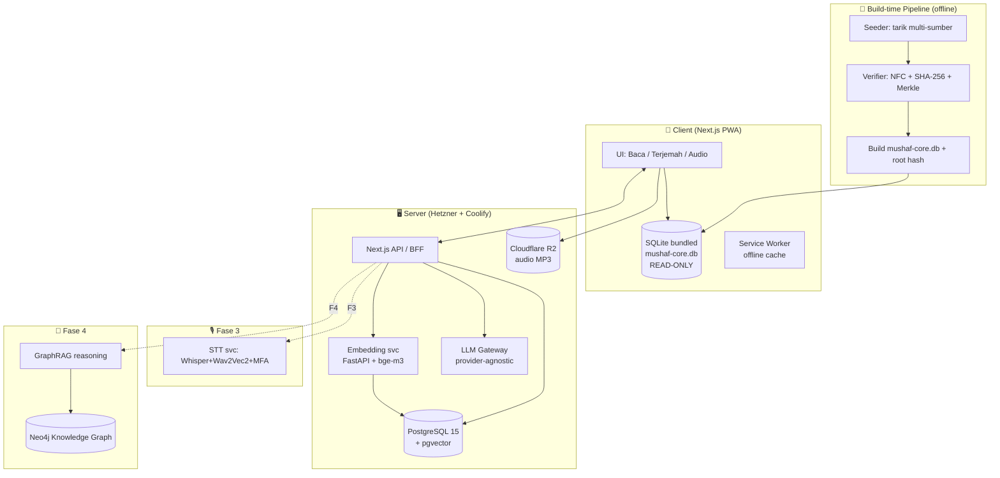
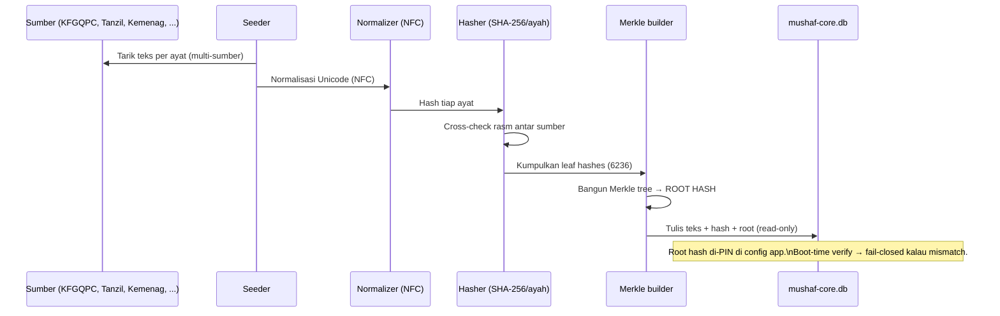

# 02 — Arsitektur & Tech Stack

> Semua keputusan di sini **sudah diambil** (decisive). Owner boleh veto, tapi default sudah jalan. Alasan singkat disertakan.

---

## 1. Prinsip arsitektur

1. **Teks kanonik = static asset immutable**, bukan "data biasa". Diperlakukan seperti kode ter-signing.
2. **Layer terpisah:** `kanonik` (immutable) ≠ `keilmuan` (tafsir/hadits, mutable/versioned) ≠ `user` (bookmark/catatan).
3. **Offline-first.** Teks inti hidup di device. Server hanya untuk sync, AI, audio, search berat.
4. **Provider-agnostic AI.** LLM & embedding bisa di-swap tanpa ganti arsitektur.
5. **Grow, don't rebuild.** Skema & RAG dirancang supaya Fase 2–4 = tambah layer.

---

## 2. Keputusan stack

| Layer | Pilihan | Alasan singkat | Alternatif (kalau perlu) |
|-------|---------|----------------|--------------------------|
| App framework | **Next.js 15 App Router + TS strict** | Match stack existing kamu, PWA, SSR+CSR fleksibel | Astro (kalau mau lebih statis) |
| Styling | **Tailwind CSS** | Cepat, konsisten | Custom CSS (kalau butuh tipografi mushaf presisi tinggi) |
| **Teks kanonik** | **SQLite bundled, read-only + checksum** | Immutable, offline, portabel, cepat | JSON static (kurang query-able) |
| App DB | **PostgreSQL 15** | Match existing, relational kuat, punya pgvector | — |
| Vector/RAG | **pgvector (extension Postgres)** | Satu DB, self-hosted, no vendor lock | Qdrant / ChromaDB (kalau scale besar) |
| Embeddings | **BAAI/bge-m3** (multilingual) | Kuat di Arab+Indo+Inggris, open, self-host | intfloat/multilingual-e5-large |
| LLM (fitur AI) | **Provider-agnostic gateway** (Groq→Gemini fallback / self-host Qwen) | Fleksibel, hemat, no lock | Ollama lokal |
| Search | **Postgres FTS + pgvector (hybrid)** | Cukup untuk Fase 1 | Meilisearch (search terjemahan super cepat) |
| STT/Tajwid (F3) | **Whisper fine-tuned + Wav2Vec2 + MFA** (microservice Python) | SOTA untuk Quran ASR & alignment | — |
| Audio storage | **Cloudflare R2** (per-ayah MP3) | Murah, match existing | S3-compatible lain |
| Deploy | **Hetzner VPS + Coolify + Docker** | Match existing | — |
| Knowledge graph (F4) | **Neo4j** | Standar KG, cocok GraphRAG | Postgres+AGE (kalau mau 1 DB) |

---

## 3. Diagram sistem (high-level)



---

## 4. Kenapa teks kanonik di SQLite bundled (bukan API live)?

**[TEKNIS]** Ini keputusan penting & sengaja:
- **Immutability:** file dikirim bareng app, read-only, checksummed. Nggak bisa "berubah diam-diam" dari server.
- **Offline:** Quran harus bisa dibaca tanpa internet. Titik.
- **Anti vendor-lock:** nggak bergantung uptime/pricing API pihak ketiga untuk hal paling inti.
- **Kecepatan:** query lokal = instan.
- **Provenance:** root hash di-pin di source code → siapa pun bisa verifikasi build.

API live tetap dipakai, tapi hanya untuk hal **non-kanonik**: tafsir baru, AI, audio streaming, sync bookmark.

---

## 5. Pipeline build-time (kritis untuk keaslian)



Detail sumber & aturan verifikasi → `04_DATA_SOURCES.md`.

---

## 6. Struktur repo (usulan)

```
mushaf/
├── CLAUDE.md
├── docs/                      # dokumentasi ini
├── apps/
│   └── web/                   # Next.js 15 PWA
├── packages/
│   ├── mushaf-core/           # SQLite + loader + verifier (immutable engine)
│   ├── ui/                    # komponen shared
│   └── types/                 # TS types shared
├── services/
│   ├── embedding/             # FastAPI + bge-m3
│   ├── llm-gateway/           # provider-agnostic
│   └── stt/                   # (Fase 3) Whisper+MFA
├── pipeline/
│   ├── seed/                  # tarik multi-sumber
│   ├── verify/                # NFC+hash+merkle
│   └── build-core-db.ts       # hasilkan mushaf-core.db + root hash
├── db/
│   ├── migrations/            # Postgres
│   └── seed/                  # tafsir/hadits/terjemahan (versioned)
└── docker-compose.yml
```

Monorepo (Turborepo/pnpm) — match kebiasaan kamu.

---

## 7. Environment & deploy

- Dev: `docker-compose up` (Postgres+pgvector, embedding svc, web).
- Prod: Coolify di Hetzner, tiap service = container.
- Audio: R2 bucket, di-CDN.
- Secret: LLM keys di env, provider bisa di-swap via config.
