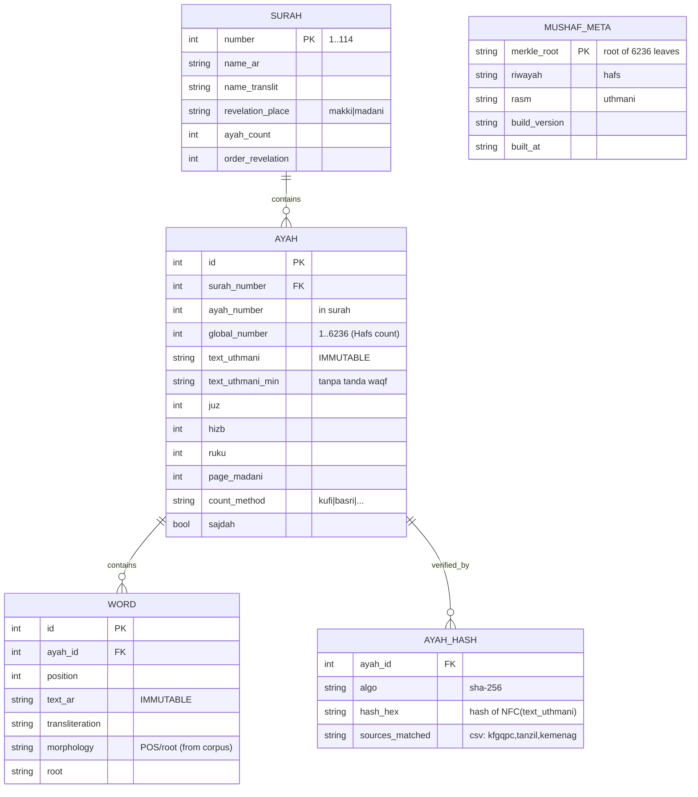

# 03 — ERD & Data Model

> Dua "zona" data: **KANONIK** (immutable, di SQLite bundled) & **KEILMUAN + USER** (di Postgres). ERD memisahkan keduanya secara eksplisit.

---

## 1. ERD — Zona KANONIK (immutable, SQLite `mushaf-core.db`)



**Aturan zona kanonik:**
- Tabel di atas **read-only** di runtime. Tidak ada API mutasi.
- `text_uthmani` & `WORD.text_ar` = harfiah, ter-hash, ter-Merkle.
- `MUSHAF_META.merkle_root` di-pin di config app → boot verify.

---

## 2. ERD — Zona KEILMUAN + USER (Postgres, versioned/mutable)

```mermaid
erDiagram
    AYAH_REF ||--o{ TRANSLATION : has
    AYAH_REF ||--o{ TAFSIR : has
    AYAH_REF ||--o{ ASBAB_NUZUL : has
    AYAH_REF ||--o{ AYAH_HADITH : cited_by
    HADITH   ||--o{ AYAH_HADITH : links
    HADITH   ||--o{ HADITH_ISNAD : has
    NARRATOR ||--o{ HADITH_ISNAD : appears_in
    AYAH_REF ||--o{ AUDIO_TIMING : timed_by
    RECITER  ||--o{ AUDIO_TIMING : recorded
    AYAH_REF ||--o{ EMBEDDING : vectorized
    SOURCE   ||--o{ TRANSLATION : provides
    SOURCE   ||--o{ TAFSIR : provides
    SOURCE   ||--o{ HADITH : provides
    USER     ||--o{ BOOKMARK : saves
    USER     ||--o{ USER_NOTE : writes

    AYAH_REF {
        int global_number PK "1..6236 (FK ke kanonik)"
        int surah
        int ayah
    }
    SOURCE {
        int    id PK
        string name "e.g. Tafsir Kemenag"
        string author
        string type "translation|tafsir|hadith|audio"
        string license "CC-BY|public-domain|..."
        string url
        string version
        string lang
    }
    TRANSLATION {
        int    id PK
        int    ayah_ref FK
        int    source_id FK
        string lang "id|en|ar|..."
        text   text
        string transliteration
    }
    TAFSIR {
        int    id PK
        int    ayah_ref FK
        int    source_id FK
        string lang
        text   body
        int    range_start "kalau tafsir per-range"
        int    range_end
    }
    ASBAB_NUZUL {
        int    id PK
        int    ayah_ref FK
        int    source_id FK
        text   narrative
        string grade "shahih|hasan|..."
    }
    HADITH {
        int    id PK
        int    source_id FK "collection: bukhari|muslim|..."
        string collection
        string ref_number
        text   text_ar
        text   text_translation
        string grade "shahih|hasan|daif|..."
    }
    NARRATOR {
        int    id PK
        string name
        string kunyah
        text   biography
        string reliability "tsiqah|..."
        string era
    }
    HADITH_ISNAD {
        int    hadith_id FK
        int    narrator_id FK
        int    position "urutan dalam sanad"
    }
    AYAH_HADITH {
        int ayah_ref FK
        int hadith_id FK
        string relation "tafsir|asbab|fadhilah|..."
    }
    RECITER {
        int    id PK
        string name
        string riwayah "hafs|warsh|..."
        string style "murattal|mujawwad"
    }
    AUDIO_TIMING {
        int    id PK
        int    ayah_ref FK
        int    reciter_id FK
        string audio_url "R2"
        json   word_timings "word-level ms (opsional)"
        int    duration_ms
    }
    EMBEDDING {
        int     ayah_ref FK
        string  space "translation-id|arabic|tafsir"
        vector  vec "pgvector, dim=1024 (bge-m3)"
        string  model
    }
    USER {
        uuid   id PK
        string handle
    }
    BOOKMARK {
        int    id PK
        uuid   user_id FK
        int    ayah_ref
        string label
    }
    USER_NOTE {
        int    id PK
        uuid   user_id FK
        int    ayah_ref
        text   note "CATATAN USER — terpisah total dari teks kanonik"
    }
```



**Aturan zona keilmuan:**
- `AYAH_REF.global_number` = jembatan ke zona kanonik (foreign concept, bukan FK fisik lintas-DB).
- Semua konten keilmuan **wajib** `source_id` → provenance.
- `USER_NOTE` **tidak pernah** boleh render bercampur seolah bagian teks kanonik.

---

## 3. DDL inti (Postgres) — cuplikan

```sql
-- SUMBER (provenance jantungnya)
CREATE TABLE source (
    id          SERIAL PRIMARY KEY,
    name        TEXT NOT NULL,
    author      TEXT,
    type        TEXT NOT NULL CHECK (type IN ('translation','tafsir','hadith','audio','asbab')),
    license     TEXT NOT NULL,           -- WAJIB isi
    url         TEXT,
    version     TEXT,
    lang        TEXT
);

CREATE TABLE translation (
    id          SERIAL PRIMARY KEY,
    ayah_ref    INT  NOT NULL,           -- 1..6236
    source_id   INT  NOT NULL REFERENCES source(id),
    lang        TEXT NOT NULL,
    text        TEXT NOT NULL,
    transliteration TEXT,
    UNIQUE (ayah_ref, source_id, lang)
);

-- EMBEDDING (pgvector) — untuk RAG
CREATE EXTENSION IF NOT EXISTS vector;
CREATE TABLE embedding (
    id          SERIAL PRIMARY KEY,
    ayah_ref    INT NOT NULL,
    space       TEXT NOT NULL,           -- 'translation-id' | 'arabic' | 'tafsir'
    model       TEXT NOT NULL,
    vec         VECTOR(1024) NOT NULL    -- bge-m3
);
CREATE INDEX ON embedding USING hnsw (vec vector_cosine_ops);
```

```sql
-- Contoh jaga IMMUTABILITY di sisi kanonik (SQLite):
-- 1) buka DB read-only:  PRAGMA query_only = ON;
-- 2) tidak ada endpoint UPDATE untuk tabel ayah/word.
-- 3) trigger penjaga (kalau DB read-write terpaksa):
CREATE TRIGGER ayah_no_update
BEFORE UPDATE ON ayah
BEGIN
  SELECT RAISE(ABORT, 'Teks kanonik immutable — mutasi ditolak');
END;
```

---

## 4. Peta Fase → tabel

| Fase | Tabel utama diaktifkan |
|------|------------------------|
| 1 | `SURAH, AYAH, WORD, AYAH_HASH, MUSHAF_META, SOURCE, TRANSLATION, RECITER, AUDIO_TIMING, EMBEDDING(translation), USER, BOOKMARK, USER_NOTE` |
| 2 | `TAFSIR, ASBAB_NUZUL, HADITH, NARRATOR, HADITH_ISNAD, AYAH_HADITH, EMBEDDING(tafsir)` |
| 3 | (+STT) `RECITATION_ATTEMPT, TAJWID_FEEDBACK` (skema di roadmap F3) |
| 4 | (+KG) mirror ke Neo4j: nodes `Ayah, Word, Root, Theme, Narrator, Concept`; edges `CITES, ELABORATES, ANALOGOUS_TO, TRANSMITTED_BY` |
