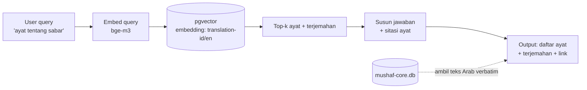
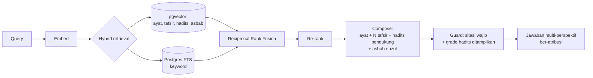
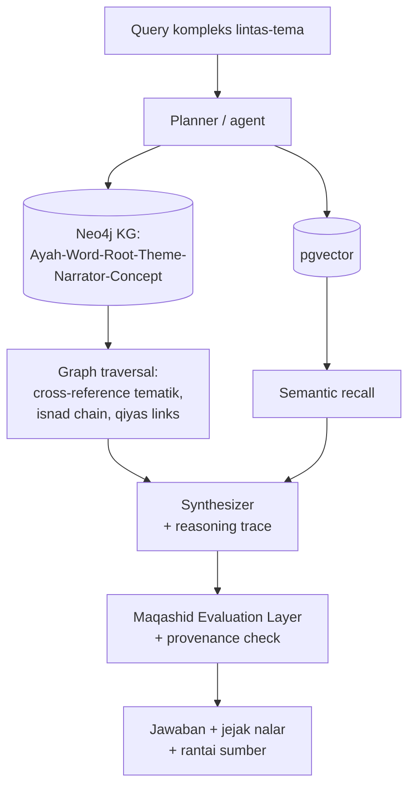

# 05 — RAG Design (tumbuh dari Fase 1 → Fase 4)

> RAG di sini dirancang **grounded & jujur** (domain suci = zero halusinasi tolerance), dan **berevolusi**: mulai retrieval sederhana (F1) → multi-source tafsir/hadits (F2) → GraphRAG reasoning (F4).

---

## 1. Prinsip RAG untuk domain Quran

**[KONSEP → TEKNIS]**
1. **AI tidak menafsir sendiri.** AI hanya **mengambil, menyusun, menyitir** dari sumber ber-atribusi. Interpretasi = milik ulama/sumber, bukan model.
2. **Sitasi wajib.** Setiap klaim → tunjuk `source_id` + ayat/hadits/ref. Tanpa sumber → tidak boleh keluar.
3. **Teks kanonik tidak pernah di-generate ulang oleh LLM.** Ayat Arab selalu diambil verbatim dari `mushaf-core.db`, bukan "diketik" model (cegah korupsi teks).
4. **"Tidak yakin" adalah jawaban valid.** Kalau retrieval lemah → sistem bilang tidak cukup sumber, jangan mengarang.
5. **Muhkam vs mutashabih.** Tandai tingkat kejelasan/kerumitan → tampilkan confidence & keragaman tafsir, bukan jawaban tunggal palsu.

---

## 2. Arsitektur RAG per fase

### Fase 1 — "Ayat Finder" (retrieval sederhana)

- Isi vector store: embedding **terjemahan** (ID/EN) + opsional teks Arab.
- Output: daftar ayat relevan + terjemahan + sitasi. **Belum** ada tafsir bebas.

### Fase 2 — "Multi-source Tafsir/Hadits RAG"

- **Hybrid** (dense + keyword) + **RRF** + re-rank → recall tinggi untuk teks klasik.
- Tampilkan **beberapa tafsir** side-by-side (Ibn Kathir / Jalalayn / Kemenag) — user bandingkan sendiri.
- Hadits pendukung tampil dengan **grade** (shahih/hasan/daif) + sanad ringkas.

### Fase 4 — "GraphRAG Reasoning" (proyek sintesis)

- Retrieval bukan cuma "mirip", tapi **relasi** (ayat A meng-elaborasi B, hadits X men-tafsir ayat Y, tema Z lintas-surah).
- Detail konsep Fase 4 → lihat `06_ROADMAP.md` (Synthesis Engine).

---

## 3. Data → Embedding (spaces)

| Space | Isi | Model | Dim | Fase |
|-------|-----|-------|-----|------|
| `translation-id` | terjemahan ID | bge-m3 | 1024 | 1 |
| `translation-en` | terjemahan EN | bge-m3 | 1024 | 1 |
| `arabic` | teks Arab (opsional) | bge-m3 | 1024 | 1.5 |
| `tafsir` | body tafsir (chunked) | bge-m3 | 1024 | 2 |
| `hadith` | teks hadits | bge-m3 | 1024 | 2 |

- **Chunking tafsir:** per-ayat atau per-paragraf, simpan `range_start/end` + `source_id`.
- **bge-m3** dipilih karena kuat multilingual (Arab+Indo+Inggris) & open/self-host.

---

## 4. Guardrails (implementasi konkret)

```
GENERATE hanya jika:
  - retrieval_score >= threshold, DAN
  - ada >=1 source ber-atribusi.
JIKA tidak: balas "Belum cukup sumber untuk menjawab ini."

SETIAP kalimat jawaban:
  - map ke source_id (footnote/inline citation).
TEKS ARAB:
  - SELALU verbatim dari mushaf-core.db (by global_number), TIDAK dari LLM.
HADITS:
  - selalu tampilkan grade + koleksi + nomor.
PERBEDAAN PANDANGAN:
  - tampilkan sebagai daftar, jangan pilih satu diam-diam.
```

---

## 5. Kenapa desain ini "dengan tujuan kamu"

- **Fase 1 RAG** = fitur produk (ayat finder) **sekaligus** infrastruktur yang di Fase 2 tinggal ditambah tafsir/hadits, dan di Fase 4 jadi substrat GraphRAG.
- **Grounded + provenance** = bukan cuma etika, tapi **fondasi Fase 4**: reasoning yang bisa dilacak sumbernya (sanad komputasional).
- **Seed terbatas → output tak terbatas:** teks tetap (immutable), tapi *lens* (query, bahasa, tema, kombinasi sumber) menghasilkan output tak terbatas. Persis metafora North Star kamu.
