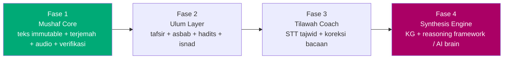
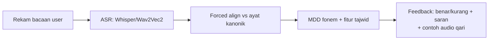
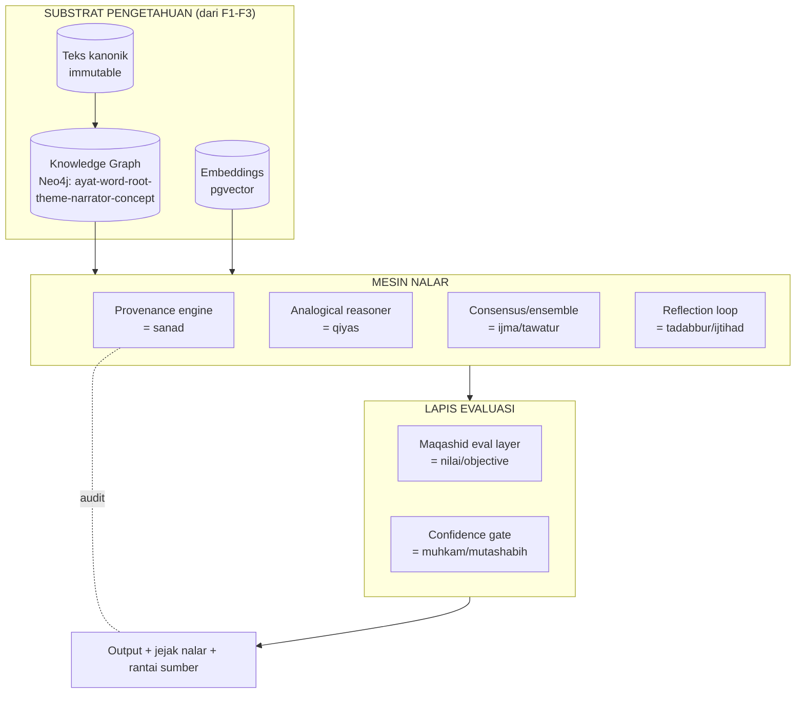
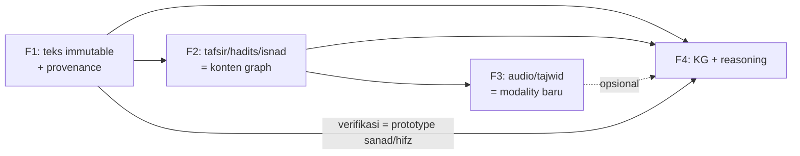

# 06 — Roadmap (Fase 1 → 4)

> Urutan **LOCKED**: 1 → 2 → 3 → 4. Tiap fase = fondasi fase berikutnya. Jangan lompat.

---

## FASE 1 — Mushaf Core 🎯 (build sekarang)

**Tujuan:** duplikasi harfiah Al-Quran digital, terverifikasi, offline, multi-bahasa.

### Sprint plan
| Sprint | Deliverable | DoD |
|--------|-------------|-----|
| 1.0 | Pipeline seed + verifier (1 surah kecil, 3 sumber) | root hash mini reproducible, skeleton identik |
| 1.1 | Full seed 114 surah + Merkle root + `mushaf-core.db` | 6236 ayat lolos verify |
| 1.2 | App shell Next.js PWA + reader (Arab + navigasi) | offline baca jalan |
| 1.3 | Terjemahan ID+EN + transliterasi + provenance UI | side-by-side + atribusi |
| 1.4 | Audio (2–3 qari) + highlight sinkron + download | offline audio |
| 1.5 | Fitur "Integritas" (hash/ayat, root, boot-verify) | fail-closed teruji |
| 1.6 | Search terjemahan + Ayat Finder (RAG F1) | sitasi wajib |
| 1.7 | Bookmark, last-read, catatan, settings | data user terpisah |
| 1.8 | **Model interaksi cursor-mode** (Baca, Identitas/magnifier + panel samping, Tilawah/senter, Leksikon, Anotasi, Salin/Bagikan) | ganti mode instan, panel buka/tutup, auditable — lihat `08_INTERACTION_MODEL.md` |
| 1.9 | **Responsif/mobile** (mode-switcher touch, bottom-sheet, drawer, ≥44px) | lulus uji 3 breakpoint (mobile/tablet/desktop) |

> **Status aktual (2026-07-06):** sprint 1.0–1.5 sudah jalan lebih cepat dari rencana —
> pipeline + `mushaf-core.db` + app PWA + audio Qari + word-by-word + identitas ayat (mint) +
> anotasi + halaman Integritas semua sudah ADA (lihat `07_EPISODIC.md` F1.0–F1.3).
> Berikutnya fokus **1.8 (cursor-mode)** & **1.9 (responsif)**.

**Keluar Fase 1 dengan:** produk Quran digital yang bisa dipakai harian + bisa dibuktikan asli.

### Model interaksi (cursor-mode) — ringkas
Interaksi berbasis **mode**; kursor = alat aktif. Detail lengkap + mobile + "adapalagi" di
**`08_INTERACTION_MODEL.md`**. Inti (ide owner):
- **Baca** (pointer) — baca biasa.
- **Identitas** (magnifier) — hover/klik kata/ayat → seleksi ber-identitas → **panel slide dari samping** (buka/tutup): hash + Merkle proof + info kata + anotasi.
- **Tilawah** (senter) — klik ayat → **Qari bacakan**.
- **Latih Baca** (mic, Fase 3) — **karaoke + AI eval**: mic nyala, ayat aktif gaya karaoke, AI nilai bacaan & kasih feedback per kata (makhraj/madd/…) → iterasi & optimasi.
- Tambahan: Leksikon, Tafsir, Terjemah/Bandingkan, Bookmark, Salin/Bagikan, Hafalan, Tajwid-warna, Tema/Akar (graph), Mint.

---

## FASE 2 — Ulum Layer 📚

**Tujuan:** tambah lapisan ilmu di atas teks (yang kamu sebut poin 2).
**Riset & konsep lengkap → `09_ULUM_SANAD_RESEARCH.md`. Sistem kontribusi/moderasi → `10_CONTRIBUTION_MODERATION.md`.**

- Tafsir **multi-sumber, tak terbatas** (Ibn Kathir, Jalalayn, Tabari, Kemenag, al-Muyassar, spa5k 122 tafsir) — 1 ayat/kata bisa banyak makna, side-by-side, **multi-bahasa**.
- **Asbabun nuzul** (al-Wahidi ~570, al-Suyuti, tafsircenter 201 isnad) — tiap ayat bisa punya banyak kisah, ber-grade & isnad.
- **Sanad · talaqqi · ijazah** — graf silsilah guru→murid; ijazah digital (AI-assist, otoritas guru manusia). Hafidz/muroja'ah (SRS).
- **Qira'at & perawi** — 10 qira'at (AQQD, KFGQPC) sebagai layer opsional; **Hafs tetap default**.
- **Hadits pendukung** per-ayat + **grade**; **perawi & isnad** (MIS/Sanadset skema) → bahan graph F4.
- **RAG F2** (multi-source, hybrid + RRF, multi-bahasa).
- **Close-development + moderasi:** semua tambahan keilmuan lewat **admin moderasi** (RBAC, versioned, provenance/sanad wajib) — lihat `10`.

**[KONSEP] Netralitas:** simpan `source` + `grade` + `tradition` sebagai metadata. Bisa filter per-mazhab. Tidak menghakimi.
**Global:** i18n WAJIB (UI + konten multi-bahasa; QuranEnc 80+, fawazahmed0 90+, IslamHouse hub).

---

## FASE 3 — Tilawah Coach 🎙️

**Tujuan:** belajar baca — cek benar/salah, makhraj, hukum tajwid (poin 3).

> UX-nya = mode **"Latih Baca"** (kursor mikrofon, gaya **karaoke + AI eval**): mic nyala →
> ayat aktif karaoke → AI dengar → nilai + feedback per kata → user iterasi & optimasi.
> Spesifikasi UX lengkap di `08_INTERACTION_MODEL.md` §4.

### [TEKNIS] State-of-the-art (dari riset)
- **ASR Quran:** Whisper fine-tuned (mis. model **tarteel-ai** di HuggingFace), **Wav2Vec2** Arab. WER untuk domain Quran bisa sangat rendah bila fine-tuned pada resitasi.
- **Forced alignment:** **Montreal Forced Aligner (MFA)** atau CTC-based → cocokkan audio user ke teks kanonik per-kata/fonem.
- **Dataset:** **EveryAyah** (resitasi ber-timing), plus dataset akademik (QDAT, Ar-PhonLab, dsb) untuk error/tajwid labels.
- **MDD (Mispronunciation Detection & Diagnosis):** deteksi + diagnosa kesalahan pada level fonem.

### Yang bisa dideteksi otomatis (realistis)
| Aspek | Feasibility | Metode |
|-------|-------------|--------|
| Kata salah / lompat ayat | ✅ tinggi | forced alignment vs teks |
| Makhraj kasar (huruf tertukar) | 🟡 sedang | MDD fonem |
| **Madd** (panjang bacaan) | ✅ sedang-tinggi | durasi vokal (acoustic) |
| **Ghunnah / dengung** | 🟡 sedang | fitur nasal |
| **Qalqalah** | 🟡 sedang | deteksi burst |
| **Idgham/Ikhfa/Iqlab** | 🟠 lebih sulit | butuh model khusus + label |

> **Jujur:** tajwid halus (mis. tingkat ikhfa) susah 100% otomatis. Rancang sebagai **coach + feedback**, bukan hakim mutlak. **[KONSEP]** approximasi *talaqqi* (belajar langsung ke guru) — feedback loop, bukan pengganti guru.

### Arsitektur (microservice)

**Skema tambahan F3:** `RECITATION_ATTEMPT(user, ayah_ref, audio, transcript, score)`, `TAJWID_FEEDBACK(attempt, rule, position, verdict, note)`.

---

## FASE 4 — Synthesis Engine 🧠 (proyek riset baru, terpisah)

> Jawaban untuk pertanyaan besarmu: *"Kalau seluruh isi & struktur Al-Quran disintesis jadi machine learning / dasar berpikir komputasional / AI brain / agent — bentuknya seperti apa?"*

### [KONSEP] Framing yang dijaga
Ini **ekstraksi POLA penalaran** dari tradisi keilmuan Islam, **diperlakukan sebagai pola rekayasa epistemologis universal** — **bukan** klaim AI = wahyu, bukan doktrin religius. (Persis pendekatan SIDIX-mu, tapi proyek ini **baru & terpisah**.)

### [KONSEP → TEKNIS] Peta: struktur Quran/keilmuan → konsep AI

| Struktur tradisi | Fungsi asli | Padanan komputasi/AI | Implementasi |
|------------------|-------------|----------------------|--------------|
| **Sanad / isnad** | rantai transmisi terverifikasi | **Provenance / data lineage** | signed chain, source graph |
| **Hifz** | penjagaan via hafalan redundan | **Integrity / checksum / replication** | Merkle, multi-source (udah di F1!) |
| **Tawatur** | transmisi massal → keyakinan | **Consensus / Byzantine fault tolerance** | quorum, ensemble agreement |
| **Ijtihad** | penalaran pada kasus baru | **Reasoning under uncertainty / inference loop** | agentic loop, tool-use |
| **Qiyas** | analogi hukum (kasus→kasus) | **Analogical / case-based reasoning** | retrieval by structural similarity |
| **Ijma** | konsensus ulama | **Multi-agent consensus / voting** | ensemble of models/personas |
| **Tafsir berlapis** | interpretasi banyak level | **Multi-resolution RAG** | layered retrieval + re-rank |
| **Muhkam vs mutashabih** | jelas vs samar | **Confidence / ambiguity handling** | calibrated uncertainty |
| **Tadabbur** | perenungan mendalam | **Chain-of-thought / self-reflection** | reflection passes |
| **Maqashid al-shari'ah** | tujuan/nilai tertinggi | **Objective / evaluation layer** | reward/eval alignment |
| **Cross-reference tematik** | ayat menjelaskan ayat | **Knowledge graph / semantic net** | Neo4j + embeddings |
| **Usul al-fiqh** | metodologi inferensi berjenjang | **Formal inference pipeline** | rule engine + priorities |

### [TEKNIS] Bentuk konkret "AI brain" itu

**Wujud produknya bisa jadi salah satu / kombinasi:**
1. **Reasoning framework / library** — pola nalar (provenance-first, analogical, consensus, reflection) yang bisa dipakai di sistem AI apa pun (bukan cuma domain agama). Ini "dasar berpikir komputasional" yang kamu maksud.
2. **Grounded knowledge engine** — KG + GraphRAG di atas corpus Quran/tafsir/hadits → mesin tanya-jawab yang **auditable** (tiap jawaban punya rantai sumber).
3. **Agentic AI dengan governance** — agent yang setiap keputusannya lewat: retrieve → analogize → consensus → reflect → **maqashid check** → output ber-provenance.
4. **Dataset/benchmark** — pola-pola ini jadi **bahan riset** untuk keilmuan lain (epistemologi AI, alignment, provenance).

### [KONSEP] Batas & kejujuran (guardrail keras)
- **Bukan** "AI yang tahu tafsir benar" — AI cuma menyusun & melacak sumber manusia.
- **Bukan** klaim mukjizat numerik ("kode 19" dst = **contested**, tidak dijadikan fondasi).
- Nilai/objective (maqashid) = **pilihan desain manusia** yang eksplisit & bisa didebat, bukan diklaim absolut dari mesin.
- Output selalu **auditable**: bisa ditelusuri balik ke sumber (itu inti kontribusinya).

### Kenapa ini kuat sebagai proyek riset
Karena kamu membalik logika biasa: alih-alih "AI menafsir Quran", kamu **mengekstrak arsitektur berpikir** yang sudah teruji ribuan tahun (provenance, integrity, analogi, konsensus, refleksi, evaluasi-nilai) dan menjadikannya **pola rekayasa** untuk AI yang *lebih auditable & grounded*. Itu kontribusi orisinal & bisa dipublikasikan/di-license.

---

## Ketergantungan antar-fase

**Insight:** F1 bukan cuma "app Quran" — verifikasi immutability-nya adalah **prototype konseptual** untuk reasoning framework F4. Kamu udah mulai membangun F4 sejak F1 tanpa sadar.
