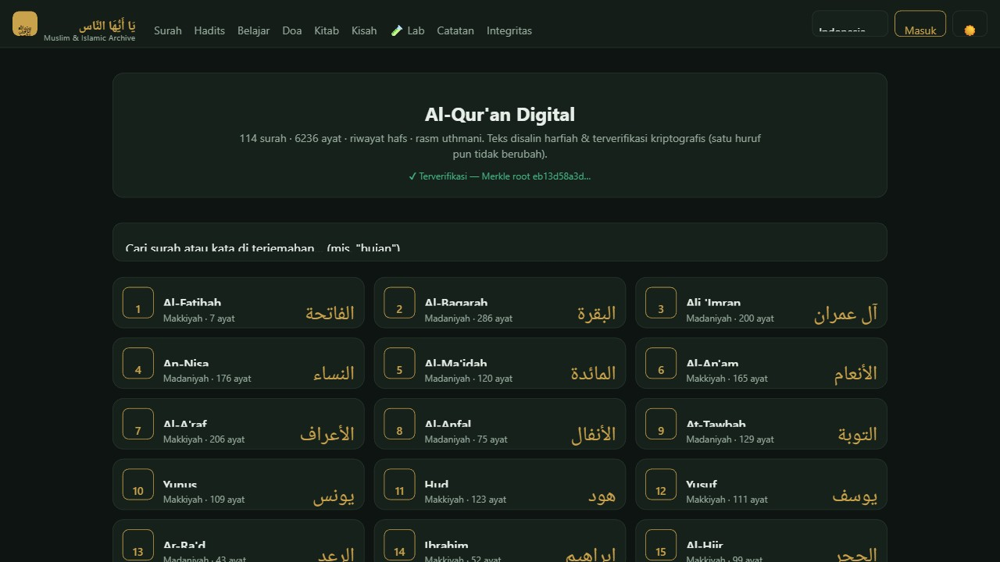

# يَا أَيُّهَا النَّاس · Ya Ayyuhan Nas

**Al-Qur'an digital yang keasliannya bisa dibuktikan — bukan sekadar dipercaya.**

*A digital Quran whose authenticity is cryptographically verifiable — 114 surahs, 6,236 verses, every verse individually hashed and bound into a single Merkle root.*

[**▶ Buka aplikasinya**](https://quran.migancore.com)

---

## Kenapa ini berbeda

Aplikasi Qur'an digital sudah banyak. Masalahnya hampir selalu sama: **kamu tidak punya
cara memeriksa apakah teks yang kamu baca masih persis seperti aslinya.** Kamu hanya bisa
percaya pada penerbit aplikasinya.

Proyek ini menjawab itu secara teknis, bukan dengan janji:

- **Setiap ayat punya hash sendiri** — 6.236 ayat, 6.236 hash.
- **Semua hash terikat dalam satu Merkle tree.** Satu huruf berubah di ayat mana pun,
  root-nya berubah, dan ketahuan seketika.
- **Root-nya dipampang di aplikasi** (`eb13d58a3d…`), bukan disembunyikan di dalam kode.

Artinya integritas teks bisa **diperiksa siapa pun secara independen** — persis semangat
sanad dalam tradisi keilmuan Islam, dinyatakan ulang dengan alat kriptografi.

Prinsip yang dipegang: **teks Al-Qur'an tidak boleh berubah satu huruf pun.** Semua fitur
AI dibangun *di sekeliling* teks, tidak pernah *mengubah* teks — dan itu ditegakkan lewat
checksum + Merkle tree + penyimpanan read-only, bukan sekadar aturan tim.

## Status

Fase 1 (Mushaf Core) **sudah berjalan**, bukan rencana:

| | |
|---|---|
| Surah | **114** lengkap |
| Ayat | **6.236** (riwayat Hafs, rasm Uthmani) |
| Hash per-ayat | **6.236** |
| Integritas | Merkle root terpampang di aplikasi |
| Pipeline | 25 skrip (build DB, indeks pencarian, statistik kepercayaan, terjemahan, manifest) |
| Aplikasi | Web PWA — [quran.migancore.com](https://quran.migancore.com) |

Sudah ada juga rintisan lapisan berikutnya di aplikasi: Hadits, Doa, Kitab, Kisah,
Catatan, dan halaman **Integritas** yang menampilkan verifikasi.

## Peta jalan

| Fase | Nama | Inti | Status |
|---|---|---|---|
| **1** | **Mushaf Core** | Duplikasi harfiah + terjemahan multi-bahasa + audio + verifikasi keaslian | ✅ **Berjalan** |
| 2 | Ulum Layer | Asbabun nuzul, kisah, perawi/isnad, riwayat, hadits pendukung, tafsir multi-sumber | Berikutnya |
| 3 | Tilawah Coach | STT tajwid — belajar baca, cek benar/salah, makhraj & hukum bacaan | Setelah 2 |
| 4 | Synthesis Engine | Struktur Qur'an → knowledge graph → kerangka penalaran (riset) | Visi |

> **North Star (tidak di-pivot):** membangun fondasi Al-Qur'an digital yang autentik &
> immutable, lalu menumbuhkan lapisan ilmu di atasnya — dan akhirnya mensintesis
> strukturnya menjadi kerangka penalaran komputasional.
>
> Metafora inti: *static-but-generative* — dari seed terbatas (teks yang tidak berubah)
> tumbuh output tak terbatas tergantung lensa (ruang, waktu, kondisi).

Detail: [`06_ROADMAP.md`](06_ROADMAP.md).

## Dokumentasi

Proyek ini didokumentasikan lebih dulu, baru dibangun. 27 dokumen, yang utama:

| File | Isi |
|---|---|
| [`01_PRD.md`](01_PRD.md) | Apa yang dibangun, scope, non-goals |
| [`02_ARCHITECTURE.md`](02_ARCHITECTURE.md) | Tech stack + arsitektur sistem |
| [`03_ERD.md`](03_ERD.md) | Data model + schema |
| [`04_DATA_SOURCES.md`](04_DATA_SOURCES.md) | Sumber corpus + audit lisensi + strategi immutability |
| [`05_RAG_DESIGN.md`](05_RAG_DESIGN.md) | Arsitektur RAG untuk lapisan AI |
| [`09_ULUM_SANAD_RESEARCH.md`](09_ULUM_SANAD_RESEARCH.md) | Riset sanad & ulum |
| [`12_ISLAMIC_VALIDATION.md`](12_ISLAMIC_VALIDATION.md) | Kerangka validasi keilmuan |
| [`10_CONTRIBUTION_MODERATION.md`](10_CONTRIBUTION_MODERATION.md) | Aturan kontribusi & moderasi |

## Sikap yang dijaga

- **Netral secara teologis.** Menyajikan konsensus keilmuan dan menandai di mana pandangan
  berbeda (mis. Sunni/Syiah soal hadits).
- **Tidak** memakai klaim kontroversial (mis. "kode 19") sebagai fondasi teknis — ditandai
  sebagai *contested* bila muncul.
- Fase 4 ("Qur'an → AI brain") = **ekstraksi pola penalaran** dari tradisi keilmuan (sanad,
  hifz, ijtihad, qiyas) — **bukan** klaim bahwa AI setara wahyu. Framing ini dijaga ketat
  agar tidak over-claim.

## Kontribusi

Perbaikan yang menyangkut teks, terjemahan, atau tafsir **wajib menyertakan rujukan sumber
yang bisa diverifikasi** — lihat [`10_CONTRIBUTION_MODERATION.md`](10_CONTRIBUTION_MODERATION.md)
dan [`12_ISLAMIC_VALIDATION.md`](12_ISLAMIC_VALIDATION.md).

## Lisensi

[MIT](LICENSE) untuk perangkat lunaknya. Teks Al-Qur'an bukan milik siapa pun; terjemahan,
tafsir, dan data pihak ketiga tunduk pada lisensi masing-masing — lihat [`NOTICE.md`](NOTICE.md)
dan [`04_DATA_SOURCES.md`](04_DATA_SOURCES.md).

**Fahmi Ghani** · PT Tiranyx Digitalis Nusantara

